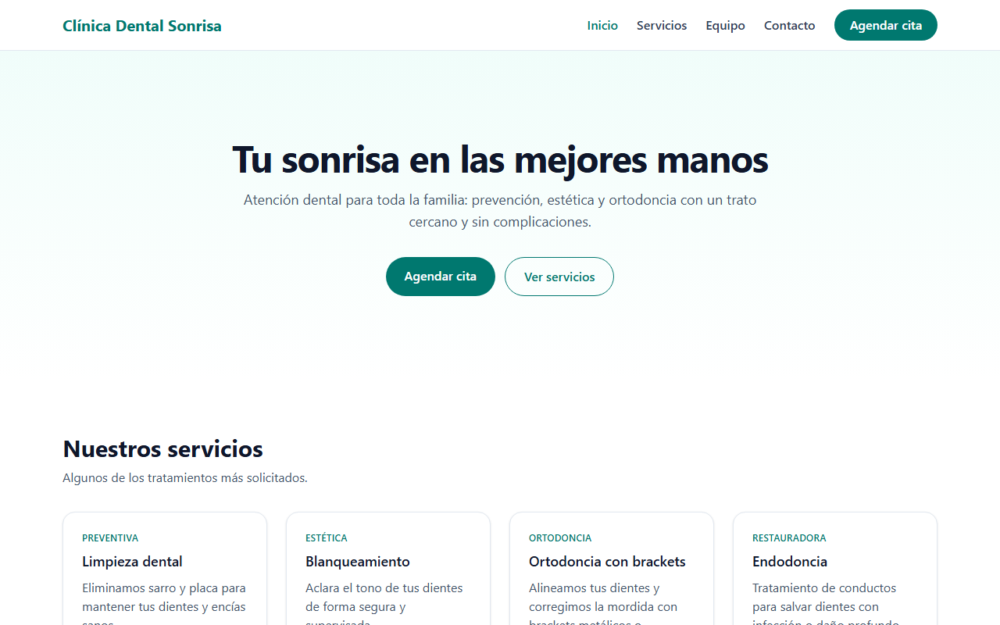
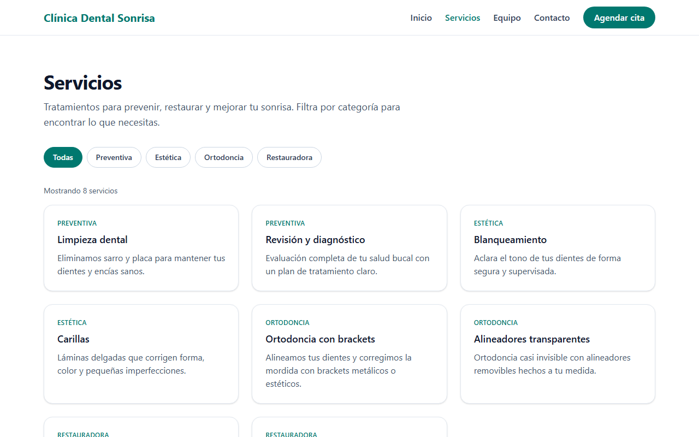
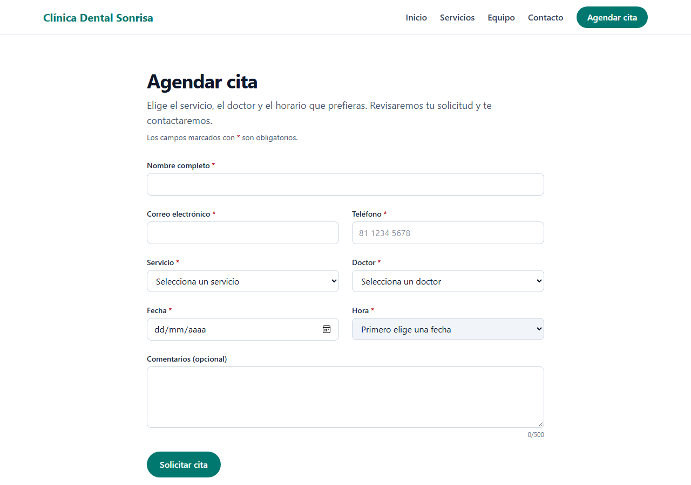
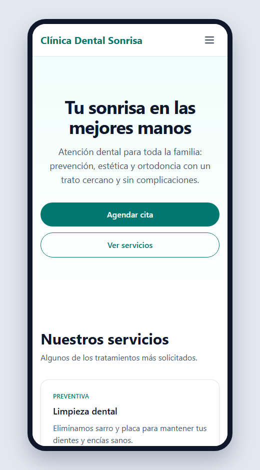

# Clínica Dental Sonrisa

Sitio web de una clínica dental **ficticia**, construido con Vue 3, TypeScript y Tailwind CSS como proyecto de portafolio.

**Demo:** [clinica-dental-vue.netlify.app](https://clinica-dental-vue.netlify.app)

> La clínica, los doctores y los datos de contacto son inventados. Los formularios funcionan, pero ninguna cita ni mensaje llega a una clínica real.



## Funcionalidades

- **5 páginas** con Vue Router: Inicio, Servicios, Equipo, Agendar cita y Contacto, más una página 404.
- **Filtro de servicios por categoría** con estado reactivo (`ref` + `computed`).
- **Formulario de citas** con validación en el cliente:
  - las horas disponibles dependen del día elegido y del horario de la clínica;
  - solo acepta fechas entre mañana y los próximos 60 días, en días hábiles;
  - los errores aparecen al salir del campo o al enviar, y el foco salta al primer campo con error.
- **Formularios conectados a Netlify Forms**, con estados de envío y error y un campo trampa (*honeypot*) contra bots.
- **Diseño responsive**, pensado primero para móvil.
- **Accesibilidad:**
  - HTML semántico y un solo `h1` por página;
  - enlace "Saltar al contenido";
  - foco al título de la nueva página al navegar, para lectores de pantalla;
  - errores de formulario con `aria-invalid` y `aria-describedby`;
  - menú móvil usable con teclado (se cierra con Escape).
- **SEO:**
  - título, meta description y URL canónica únicos por ruta;
  - etiquetas Open Graph;
  - `sitemap.xml` y `robots.txt`.

## Capturas

| Servicios | Agendar cita | Móvil |
|---|---|---|
|  |  |  |

## Tecnologías

- [Vue 3](https://vuejs.org/) con Composition API y `<script setup lang="ts">`
- [TypeScript](https://www.typescriptlang.org/)
- [Vite](https://vite.dev/)
- [Vue Router](https://router.vuejs.org/)
- [Tailwind CSS 4](https://tailwindcss.com/)
- ESLint, oxlint y Prettier
- [Netlify](https://www.netlify.com/) para el hosting y Netlify Forms para los formularios

## Estructura

```
src/
  assets/        estilos globales (Tailwind)
  components/    componentes reutilizables: NavBar, SiteFooter, ServiceCard, DoctorCard, FormField
  composables/   lógica reutilizable: useFormValidation
  data/          datos estáticos: servicios, doctores, horario, datos del sitio
  router/        rutas, títulos y meta tags por página
  types/         interfaces de TypeScript
  utils/         envío a Netlify Forms
  views/         una vista por página
public/
  _redirects     hace que Vue Router funcione en Netlify al recargar cualquier ruta
```

## Cómo ejecutarlo

Requiere Node.js `^22.18.0` o `>=24.12.0`.

```sh
npm install
npm run dev       # servidor de desarrollo en http://localhost:5173
npm run build     # comprobación de tipos + build de producción en dist/
npm run lint      # oxlint + ESLint
npm run format    # Prettier
```

En desarrollo, los formularios no se envían: los datos se muestran en la consola del navegador. El envío real solo funciona desplegado en Netlify.

## Decisiones técnicas

- **Datos separados de los componentes.** Servicios, doctores y horario viven en `src/data/` con tipos en `src/types/`. El horario se usa en dos lugares: para calcular las horas disponibles en el formulario de citas y para mostrarlo en Contacto.
- **Un composable para los formularios.** `useFormValidation` reúne la lógica común (cuándo mostrar errores, atributos de accesibilidad, foco en el primer error). Cada formulario solo define sus reglas de validación.
- **Renderizado en el cliente (CSR).** Elegí CSR para practicar componentes, estado y rutas. Para un sitio informativo real que depende del SEO, convendría SSG o SSR (por ejemplo con Nuxt): el HTML llegaría ya generado y las rutas inexistentes podrían devolver un 404 real en lugar de un *soft 404*.
- **Solicitud, no reserva.** El formulario envía una solicitud de cita, pero no comprueba disponibilidad ni evita citas duplicadas. Un sistema de reservas real necesitaría un backend con base de datos y validación en el servidor.
